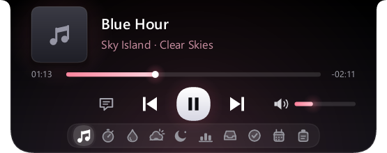
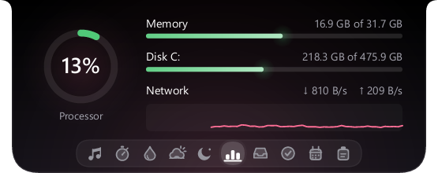
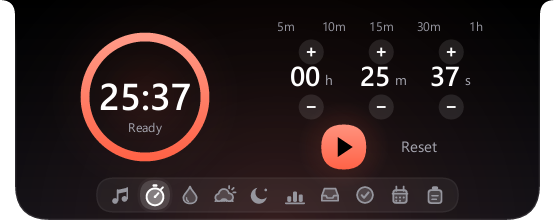
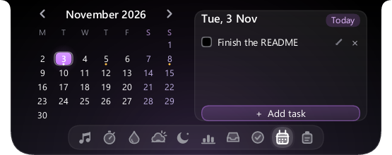
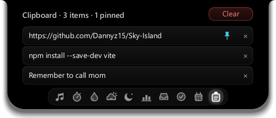

<p align="center">
  
</p>

<h1 align="center">Sky Island</h1>

<p align="center">
  <b>A notch for the top of your Windows screen.</b><br>
  Like the Dynamic Island on the iPhone, but for Windows.
</p>

<p align="center">
  
  
  
  
  
</p>

<p align="center">
  <a href="#tabs">Tabs</a> ·
  <a href="#installation">Installation</a> ·
  <a href="#using-it">Using it</a> ·
  <a href="#questions">Questions</a> ·
  <a href="#privacy">Privacy</a> ·
  <a href="#known-limitations">Limitations</a> ·
  <a href="#building-from-source">Building</a>
</p>

<p align="center">
  <a href="https://github.com/Dannyz15/Sky-Island/releases/latest"><b>⬇ Download the latest version</b></a>
</p>

---

<div align="center">
<table>
  <tr>
    <td align="center"><br><sub>Closed</sub></td>
    <td align="center"><br><sub>A song playing</sub></td>
  </tr>
  <tr>
    <td align="center"><br><sub>Eyes</sub></td>
    <td align="center"><br><sub>Music</sub></td>
  </tr>
  <tr>
    <td align="center"><br><sub>Stats</sub></td>
    <td align="center"><br><sub>Timer</sub></td>
  </tr>
  <tr>
    <td align="center"><br><sub>Calendar</sub></td>
    <td align="center"><br><sub>Clipboard</sub></td>
  </tr>
</table>
</div>

## Tabs

| Tab | What it does |
|---|---|
| 🎵 **Music** | Now playing, controls, a seek bar, synced lyrics and a volume slider. |
| ⏱️ **Timer** | Countdown to the exact second, with an alarm. |
| 💧 **Water** | Daily glass counter with optional reminders. |
| 🌤️ **Weather** | Now and the next five days for your city. |
| 🕌 **Prayer** | Today's prayer times, a countdown and the Hijri date. In Malaysia they are JAKIM's official times for your zone. |
| 📊 **Stats** | Gauges for the processor, memory and each graphics chip, a live graph, network speed and every drive. |
| 📂 **Shelf** | Park files by dragging them in; drag them out later. |
| ✅ **To-do** | Tasks with reminders. |
| 📅 **Calendar** | Month or week view with your tasks. |
| 📋 **Clipboard** | History of text and pictures; pin text to keep it. |

Every tab can be switched off in Settings > Tabs. Weather and Prayer need your city (Settings > Weather & Prayer).

## Installation

**Requirements:** Windows 10 or 11 (64-bit). The setup is about 4 MB and needs no administrator rights.

1. Download `Sky-Island-Setup-<version>.exe` from the [Releases page](https://github.com/Dannyz15/Sky-Island/releases).
2. Run it. It installs for your user only.
3. The notch appears at the top of the screen, and a tray icon appears near the clock.

To update, run a newer setup, or use **Check for updates** in Settings > About. Your data is kept. To uninstall, use Windows Settings > Apps.

## Using it

Hover over the notch at the top edge of your screen to open it. Move away and it closes. It also pops up briefly when something changes on your PC, such as the volume or the battery.

Closed, the notch shows the clock, or a pair of blinking eyes in one of ten styles. While a song plays it also shows the album cover as a spinning record, with a ring that fills as the song goes on, and five bars that rise and fall with the real loudness of the music. Choose the look in Settings > Closed notch.

## Questions

<details>
<summary>Windows shows a warning when I run the setup.</summary>

The setup is not code-signed, so Windows may show "Windows protected your PC". Click **More info**, then **Run anyway**. If Smart App Control blocks it completely (error 4551), turn Smart App Control off in Windows Security.

A program that is not signed and is new to Windows can also be flagged by mistake by Microsoft Defender or another antivirus (a false positive). If that happens, open Windows Security > Protection history, allow the file, and you can tell Microsoft it is safe at the [file submission page](https://www.microsoft.com/en-us/wdsi/filesubmission) (choose that you are the developer or that the detection is incorrect). The whole source code is public, so you can also build the program yourself (see Building from source).
</details>

<details>
<summary>The notch disappeared.</summary>

It hides while a full-screen app, such as a game or a video, is on the same screen (Settings > Behaviour > **Hide in full screen**). **Auto-hide notch** in the same page slides it away when you are not using it: move the mouse to the top edge to bring it back.
</details>

<details>
<summary>Weather and Prayer ask for a city.</summary>

Open Settings > Weather & Prayer, type your city and press Enter, or press **Detect my location**.
</details>

<details>
<summary>I want the notch on another screen.</summary>

Settings > Behaviour > **Show on**: it shows a small map of the screens that are connected, so click the one you want (the number is the one on the map), **All** to have the notch follow the mouse to the top edge of whichever screen you use, or **Every** to keep a closed notch on each screen at once (the one you point at opens).
</details>

<details>
<summary>How do I change the eyes, or turn off the record and the bars?</summary>

Settings > Closed notch. **Eye style** is a grid of ten styles; pick one to see it on the notch. **Show music** turns the record and the bars off, or you can keep it and switch off **Moving bars**, **Spinning record** or **Edge glow** one by one. **Bars follow the sound** makes the bars listen to the sound your PC plays; switched off, they move to a made-up beat.
</details>

<details>
<summary>Where is my data, and how do I start over?</summary>

In `%APPDATA%\Sky-Island`. Settings > About has **Open data folder** and **Reset to defaults**.
</details>

<details>
<summary>Sky Island closed by itself.</summary>

When the app hits an error it cannot recover from, it writes a report to `crash.log` in the data folder (Settings > About > **Open data folder**): the version, the time, what went wrong and where. If you open an issue, please attach that file. A new report is added at the end of the file; the oldest are dropped when the file passes 64 KB.
</details>

Found a bug or have an idea? [Open an issue](https://github.com/Dannyz15/Sky-Island/issues).

## Privacy

Your data stays on your computer. There are no accounts and no tracking.

<details>
<summary>What is stored and what is sent</summary>

Everything is saved in `%APPDATA%\Sky-Island`. The clipboard history is kept in memory only, except text you pin (up to 10).

Network requests, and why:

- **Weather:** Open-Meteo, with your city's coordinates.
- **Prayer times:** Aladhan, with your city's coordinates. In Malaysia, JAKIM's e-Solat is asked instead, with only the code of your zone (for example SGR01).
- **Your city** (only when you type it and press Enter): OpenStreetMap's Nominatim, with the name you typed.
- **Detect my location** (only when you press it): Windows Location, then OpenStreetMap's Nominatim to name the place. The position is rounded to about a kilometre first, so it is never more exact than your area, and that is also all that is saved and sent for the weather and prayer times. If Windows Location is off, ipwho.is is asked instead and sees your IP address.
- **Lyrics:** LRCLIB, with the title, artist and length of what plays, also from a browser tab. Switch it off with **Find lyrics online** in Settings > Music; then only lyrics already saved on this PC show.
- **Updates:** GitHub, to look for a newer version at start and every 6 hours (switch off in Settings > Notices). Nothing is downloaded until you press Download.

**Sound:** while a song plays and the closed notch shows its bars, Sky Island listens to the sound your PC sends to the speakers or headphones (Windows calls it loopback) to make the bars follow the music. It only measures how loud each pitch is, about 45 times a second. Nothing is recorded, saved or sent, the microphone is not used, and it stops a moment after the bars go away. Switch it off with **Bars follow the sound** in Settings > Closed notch. It hears everything the PC plays, not only the song.

To show Caps Lock and Num Lock notices, a Windows keyboard hook checks only whether one of those two keys was pressed. It never records or sends what you type. **Start with Windows** adds one startup entry under `HKCU\Software\Microsoft\Windows\CurrentVersion\Run`.
</details>

## Known limitations

- Windows only.
- Brightness notices work only on laptop screens whose driver reports the brightness.
- Lyrics depend on what LRCLIB has.
- Song titles and lyrics in Korean, Japanese, Chinese, Thai, Hindi and other scripts are drawn with the fonts Windows already has, so a script needs its Windows font. Emoji are drawn in one colour.
- The bars on the closed notch follow all the sound the PC plays, not only the song, so a video or a notification moves them too. Some players that take the sound device for themselves (exclusive mode) cannot be listened to, and then the bars move to a made-up beat.
- Weather and prayer times need an internet connection to refresh; the last ones are kept for offline use.

## Building from source

You need:

- Windows 10 or 11 (64-bit).
- [Rust](https://rustup.rs/) through rustup. The exact compiler version is set in `rust-toolchain.toml`, and rustup installs it by itself the first time you run `cargo` in the project.
- The Visual Studio Build Tools with the **Desktop development with C++** workload (the linker and the Windows SDK, which also puts the icon and version information into the exe).
- To make the setup program only: [Inno Setup 7](https://jrsoftware.org/isinfo.php) (`winget install JRSoftware.InnoSetup.7`).

```
git clone https://github.com/Dannyz15/Sky-Island.git
cd Sky-Island
cargo run --release
```

`cargo build --release` leaves the program at `target\release\sky-island.exe`. It runs as it is, with no installer.

| To do this | Run |
|---|---|
| Run the tests | `cargo test` |
| Check the code the way the project's CI does | `cargo fmt --check` and `cargo clippy --all-targets -- -D warnings` |
| Format the code (one style for everything, set in `rustfmt.toml`) | `cargo fmt` |
| Check the crates for known problems, licences and sources | `cargo install cargo-deny --locked`, then `cargo deny check` (settings in `deny.toml`) |
| Make the setup program, `dist\Sky-Island-Setup-<version>.exe` | `powershell -ExecutionPolicy Bypass -File scripts\package.ps1` |

To try a build without touching your own settings, shelf and to-do list, start it with another data folder: in a terminal run `set APPDATA=C:\temp\sky-test` and then the program. Its data goes in `C:\temp\sky-test\Sky-Island`, and it can run next to the copy you normally use.

The version number is in two places that must match, `Cargo.toml` and `installer\sky-island.iss`; CI checks this. The app's update check only offers a release that has `Sky-Island-Setup-<version>.exe` attached.

## License

Released under the [MIT License](LICENSE). The crates it is built with, and their licences, are listed in [THIRD-PARTY-LICENSES.txt](THIRD-PARTY-LICENSES.txt).
