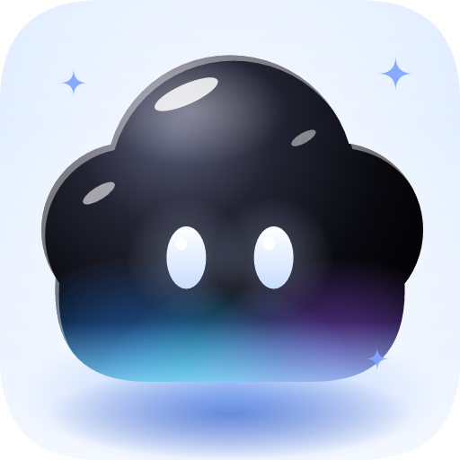

  

<h1 align="center">Sky Island</h1>

  <b>A notch for the top of your Windows screen.</b> 
  Music, lyrics, an optional timer you set yourself, an optional water tracker, a file shelf, a to-do list, a calendar and a clipboard history, all tucked into one small pill.

  
  
  

  <a href="#what-it-does">What it does</a> ·
  <a href="#installation">Installation</a> ·
  <a href="#using-it">Using it</a> ·
  <a href="#your-data-and-privacy">Privacy</a> ·
  <a href="#known-limitations">Limitations</a>

---

Sky Island sits at the top edge of your screen as a small black pill, with curved flares on both sides of its top edge, like a notch cut into the screen. Hover over it and it opens into a player, a timer, a tracker and more. Move away and it tucks itself back in. It also pops up for a moment when something changes on your PC, such as the volume or the battery.

It is written in Rust, runs natively on Windows 10 and 11, and keeps all of your data on your own computer. Everything in it moves on spring physics, so opening, hiding, switching tabs, hovering and toggling all glide instead of snapping.

## What it does

| | Tab | What you get |
|---|---|---|
| 🎵 | **Music** | What is playing in Spotify, a browser or any player that reports to Windows. Play, pause, next, previous, album art, the artist and album, and a progress bar you can drag to jump in the song, with the time played on the left and the time left on the right. The speech-bubble button opens synced lyrics beside the player. |
| ⏱️ | **Timer** | An optional countdown timer you set to the exact second, from 1 second to 24 hours, with quick choices and a progress ring. It is off until you turn it on in the settings window. |
| 💧 | **Water** | An optional daily glass counter with a goal and gentle reminders. It is off until you turn it on in the settings window. |
| 📂 | **Shelf** | A place to park files. Drag them onto the notch, and drag them out again later. |
| ✅ | **To-do** | A task list with reminders at the day and time you choose, and tasks you can edit. |
| 📅 | **Calendar** | A month view where each day shows its own tasks. |
| 📋 | **Clipboard** | A history of what you copy, both text and pictures such as screenshots. Click an item to copy it again, or clear everything with one button. |
| ⚙️ | **Settings** | Not a tab: right-click the tray icon and choose **Settings…** for a window with every switch and more (theme, animation, eye style, hover delays, volume, the timer alarm and its sound, checking for updates) and Quit. |

### It is alive even when closed

- **Eyes.** The closed notch has a pair of blinking eyes (**Enable eyes**, on by default). Choose their look with **Eye style** in the settings window: **Classic** (white with a black pupil), **Dots**, **Cat** (amber with a slit pupil) or **Glow** (glowing blue). They take the place of the clock, so they show while you work only when the clock is off.
- **A clock.** Turn on **Show clock** in the settings window and the closed notch shows the time instead. It is off by default.
- **Idle eyes.** After a while without keyboard or mouse use, the eyes appear and blink (even with the clock on). If you stay away longer, they fall asleep. When you come back, they greet you.
- **Quick notices.** For a moment, the notch grows to show a change in volume or mute, a new audio output such as headphones, brightness, Caps Lock and Num Lock, plugging in or unplugging the charger, low battery, and Wi-Fi or internet changes.
- **Out of the way.** When a fullscreen app such as a game or a video is in front, the notch hides itself.

## Installation

1. Download `Sky-Island-Setup-<version>.exe` from the [Releases page](https://github.com/Dannyz15/Sky-Island/releases).
2. Double-click it and follow the steps. It installs for your user account only, so it never asks for administrator rights. You can choose to add a desktop shortcut and to start Sky Island when you sign in to Windows.
3. Leave **Launch Sky Island** ticked on the last page. The notch appears at the top of your screen, and a tray icon appears near the clock.

> **A note about the Windows warning.** The setup is not code-signed, so Windows may show "Windows protected your PC". Click **More info**, then **Run anyway**. If Smart App Control is turned on, Windows may block the file completely (error 4551). In that case you need to turn Smart App Control off in Windows Security.

**Updating.** Run the newer setup, or press **Check for updates** in the settings window and then **Download** and **Install**. The setup closes the running app and installs over the old version, and your data is kept. Leave **Launch Sky Island** ticked on its last page to start the app again.

**Uninstalling.** Open Windows Settings, then Apps, find Sky Island and click Uninstall. At the end it asks whether to delete your data too. The default answer is No, so your settings and tasks stay unless you choose Yes.

## Using it

Hover over the notch to open it. The tab bar at the top switches between the views.

**🎵 Music.** Press on the progress bar and drag to jump to any point in the song, or just click where you want to be. Press the speech-bubble button next to the controls to open the lyrics. The notch grows wider, staying centred on the screen, and the lyrics appear to the right of the player, with the line being sung in bold. Press the button again to close them. Click any lyric line to jump to that point in the song. Scroll the mouse wheel over the lyrics to look ahead or back; the lyrics then stop following the music and a **Sync** button appears, with an arrow showing where the line being sung is. Press **Sync** to glide back to it. Lyrics come from [LRCLIB](https://lrclib.net).

**⏱️ Timer.** Switch on **Timer** in the settings window and a Timer tab appears. Set the length exactly as you like. Each plus or minus button above and below the hours, minutes and seconds changes that number by exactly one, so you can set the timer a second at a time (the mouse wheel over a number works too). Or click a number and type it: type 25, press Tab or a colon to move on, type 37, then press Enter, and the timer is 25:37. The Up and Down arrow keys change the number by one while you type, and Esc cancels. There are also quick choices: 5, 10, 15, 30 minutes or 1 hour. Press start to begin, press it again to pause and carry on later, and use **Reset** to stop and go back to the full length. The ring empties as the time runs down. The countdown also shows in the closed notch, and when time is up the notch opens and the chime sounds again every 3 seconds until you press the big red **Stop** button, like a phone's timer (only that button stops it, otherwise it stops by itself after a minute). The length you set is remembered. You can turn the chimes off with **Sounds** in the settings window.

**💧 Water.** Switch on **Water tracker** in the settings window and a Water tab appears. Press the big plus button each time you drink a glass. Set your daily goal with the minus and plus buttons (1 to 20 glasses, 8 by default). Choose a reminder every 30 minutes, 1 hour or 2 hours, or turn reminders off. Reminders stop once you reach your goal, and the count starts again every day.

**📂 Shelf.** Drag files from Explorer onto the notch. Click a tile to open the file, or press and drag it into another app. Once you drop it somewhere that takes it, the file leaves the shelf (it is moved or copied there as usual). Pressing Esc, or letting go over nothing, or dropping it back on the notch keeps it on the shelf. To take several files at once, hold **Ctrl** and click each one: it lights up in the accent colour (Ctrl+click it again to let it go, and **Esc** clears the highlight). Then drag any highlighted file and they all go together. The `×` on a tile removes it from the shelf only, and never deletes the file. The red **Clear** button at the top right takes every file off the shelf, and never deletes any of them. The shelf holds up to 50 files, and the mouse wheel scrolls through them.

**✅ To-do.** Click the box at the top and type a task. Press Enter to add it, or Esc to cancel. Tick a task to finish it, and use `×` to delete it. Click a task, or its pencil, to change it later.

The task editor lets you pick a **day** (use the arrows, or None, Today and Tomorrow) and switch on a **reminder** for an exact time. Set the hour and minute with the plus and minus buttons or with the mouse wheel, or use the quick choices: in 15 minutes, 1 hour, 3 hours, or tomorrow at 9:00. When the time comes, the notch opens with a chime. The clock follows your **24-hour clock** setting.

**📅 Calendar.** The month is on the left and today is marked in amber. Click a day to see its tasks on the right, and use the arrows to change month. Click the month name to jump back to today. Press **+ Add task** to add a task to the day you picked, and tick or delete tasks the same way as in the To-do tab. A dot under a date means it has tasks. The same tasks also show in the To-do tab, with their date at the right.

**⚙️ Settings window.** Right-click the tray icon (next to the clock) and choose **Settings…**, and a normal window opens with every setting:

- **Theme:** Dark, Light, or Follow System (the Windows theme).
- **Animation:** Calm, Normal, Snappy, or None (quick and with no bounce).
- **Eye style:** Classic, Dots, Cat or Glow, the look of the eyes on the closed notch.
- **Open delay** and **Close delay:** how long the mouse rests on the notch before it opens, and how long it is away before it closes.
- **Volume** of the chimes (you hear the new level when you let go of the slider).
- **Timer alarm:** how often it sounds again, how long it rings if nobody stops it, and the **Alarm sound**: click the button to pick your own sound file (WAV, MP3, M4A, WMA or AAC) in the normal Windows Open dialog, hear it right away, and click the × to go back to the built-in chime. A long file is left to finish instead of restarting every repeat, and the Stop button cuts it off. It follows the Volume slider.
- **Check for updates:** asks GitHub whether a newer version has been released and tells you, or that you have the latest. If there is one, the button becomes **Download**: press it and the new setup is downloaded (with the percentage shown), checked against the size and SHA-256 that GitHub reports for it, and the button becomes **Install**. Press that and the setup opens and closes Sky Island; follow its steps and leave **Launch Sky Island** ticked to start the app again. Nothing is downloaded or installed unless you press the buttons.
- **Open data folder**, **Reset to defaults** (click it twice to confirm), and **Quit Sky Island**.

Changes apply right away and are saved as you make them. Press Esc to close the window.

**🌗 Windows theme.** In the settings window choose **Follow System** under Theme and the notch switches to a light look whenever Windows is using its light theme, and back to dark when Windows goes dark. It follows changes while the app is running. With Dark or Light chosen, the notch keeps that look whatever Windows does. Album covers and file icons keep their own colours.

**🙈 Auto-hide.** Turn on **Auto-hide island** in the settings window and the notch slides up out of view whenever you are not using it, leaving only a thin edge at the top of the screen. Move the mouse to where it was and it slides back down. It also comes down by itself for timers, reminders and system notices. You can switch auto-hide on or off from the tray icon menu too.

**📋 Clipboard.** Everything you copy is added to the top of the list, newest first. Text shows as one line, and a picture, such as a screenshot, shows as a small preview with its size. Click an item to put it back on the clipboard, and use the `×` to remove one item. The **Clear** button empties the list and the Windows clipboard itself. The list keeps the last 30 items and the mouse wheel scrolls through them.

## Your data and privacy

Everything stays on your computer, in `%APPDATA%\Sky-Island`:

| File | What it holds |
|---|---|
| `settings.json` | Your settings |
| `timer.json` | The timer length you last set |
| `water.json` | Today's count, your goal and your reminder choice |
| `todo.json` | Your tasks, with their calendar day |
| `shelf.json` | The paths of the files on the shelf (the files themselves are never copied) |
| `lyrics\` | Lyrics you have already looked up |
| `crash.log` | Only written if the app crashes, with the error message |

The clipboard history is kept in memory only. It is never written to disk and it is gone when you close the app. It holds text and pictures, and it skips anything that an app, such as a password manager, marks as private. Pictures are stored compressed, and the oldest ones are dropped once they add up to about 48 MB. You can turn it off with **Clipboard history** in the settings window. Windows has its own clipboard history (Windows key + V), which Sky Island does not touch.

The app makes two kinds of network request. The lyrics lookup sends the song title, artist and length to LRCLIB. **Check for updates** asks GitHub for the latest release, and the Download button fetches its setup file from GitHub; both only when you press them, and nothing about you is sent. The downloaded setup goes in your temporary folder and is deleted by itself the next time Sky Island starts after the update (a newer setup you downloaded but did not install is kept). There are no accounts and no tracking.

To show Caps Lock and Num Lock notices, the app installs a Windows keyboard hook. It only checks whether the key pressed is Caps Lock or Num Lock. It never records, stores or sends anything you type. Some antivirus programs are cautious about any keyboard hook, so it is worth knowing about.

If you turn on **Start with Windows**, the app adds one value named `Sky Island` to your per-user startup list (`HKCU\Software\Microsoft\Windows\CurrentVersion\Run`). Turning it off removes it.

## Known limitations

- Windows only.
- Chrome and YouTube do not offer next or previous for a single video. Next is greyed out and Previous restarts the video. Playlists work normally.
- Brightness notices only work on laptop screens, and only if the graphics driver lets the app read the brightness.
- Lyrics depend on what LRCLIB has, so some songs have none.
- The clipboard history holds text and pictures, not copied files.

## License

Released under the [MIT License](LICENSE).
