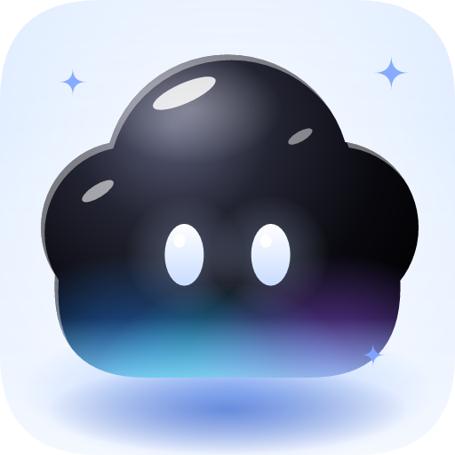

  

<h1 align="center">Sky Island</h1>

  <b>A notch for the top of your Windows screen.</b> 
  Music, lyrics, timer, weather, prayer times, file shelf, to-do, calendar and clipboard in one small pill.

  
  
  

---

Sky Island sits at the top edge of your screen. Hover over it to open it, move away to close it. It also pops up briefly when something changes on your PC, such as the volume or the battery.

## Tabs

| Tab | What it does |
|---|---|
| 🎵 **Music** | Now playing, controls, a seek bar, synced lyrics and a volume slider. |
| ⏱️ **Timer** | Countdown to the exact second, with an alarm. |
| 💧 **Water** | Daily glass counter with optional reminders. |
| 🌤️ **Weather** | Now and the next five days for your city. |
| 🕌 **Prayer** | Today's prayer times, a countdown and the Hijri date. |
| 📊 **Stats** | Processor, memory, disk and network. |
| 📂 **Shelf** | Park files by dragging them in; drag them out later. |
| ✅ **To-do** | Tasks with reminders. |
| 📅 **Calendar** | Month or week view with your tasks. |
| 📋 **Clipboard** | History of text and pictures; pin text to keep it. |

Every tab can be switched off in Settings. Weather and Prayer need your city (Settings > Location).

## Installation

1. Download `Sky-Island-Setup-<version>.exe` from the [Releases page](https://github.com/Dannyz15/Sky-Island/releases).
2. Run it. It installs for your user only and never asks for administrator rights.
3. The notch appears at the top of the screen, and a tray icon appears near the clock.

To update, run a newer setup, or use **Check for updates** in Settings > About. Your data is kept. To uninstall, use Windows Settings > Apps.

## Using it

- Hover over the notch to open it. Switch tabs with the tab bar or the mouse wheel.
- Right-click the tray icon and choose **Settings…** for everything else: theme, animation, size, screen, hotkey, hover delays, sounds, tabs, location and notices.
- To quit, choose **Exit** in the tray menu.

## Privacy

Your data stays on your computer, in `%APPDATA%\Sky-Island`. There are no accounts and no tracking. The clipboard history is kept in memory only, except text you pin (up to 10).

Network requests, and why:

- **Weather:** Open-Meteo, with your city's coordinates.
- **Prayer times:** Aladhan, with your city's coordinates.
- **Detect my location** (only when you press it): Windows Location, then OpenStreetMap's Nominatim to name the place. If Windows Location is off, ipwho.is is asked instead and sees your IP address.
- **Lyrics:** LRCLIB, with the song title, artist and length.
- **Updates:** GitHub, to look for a newer version at start and every 6 hours (switch off in Settings > Notices). Nothing is downloaded until you press Download.

To show Caps Lock and Num Lock notices, a Windows keyboard hook checks only whether one of those two keys was pressed. It never records or sends what you type. **Start with Windows** adds one startup entry under `HKCU\Software\Microsoft\Windows\CurrentVersion\Run`.

## Known limitations

- Windows only.
- Brightness notices work only on laptop screens whose driver reports the brightness.
- Lyrics depend on what LRCLIB has.
- Weather and prayer times need an internet connection to refresh; the last ones are kept for offline use.

## License

Released under the [MIT License](LICENSE). The crates it is built with, and their licences, are listed in [THIRD-PARTY-LICENSES.txt](THIRD-PARTY-LICENSES.txt).
